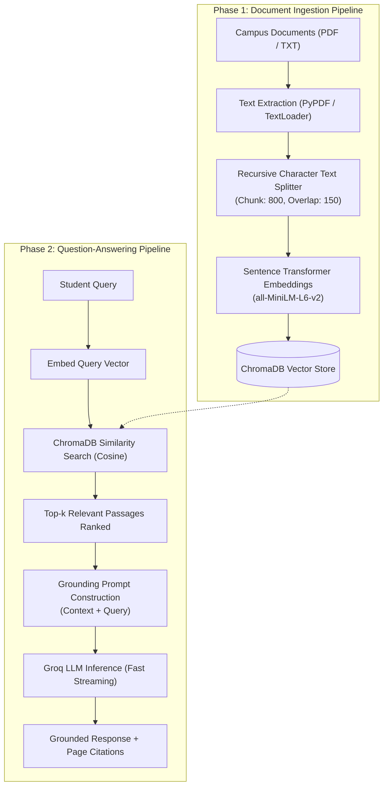

# 🎓 Campus Knowledge Assistant — PDF & Multi-Document RAG Chatbot

<p align="center">
  
</p>

<p align="center">
  <strong>An AI-powered Retrieval-Augmented Generation (RAG) assistant designed for academic campuses. Built with Python, LangChain, ChromaDB, Hugging Face Embeddings, Groq LLM, and Streamlit.</strong>
</p>

<p align="center">
  
  
  
  
  
  
</p>

---

## 📋 Table of Contents
- [📌 1. Project Overview](#-1-project-overview)
- [🚀 2. Key Features](#-2-key-features)
- [🏛️ 3. System Architecture](#️-3-system-architecture)
- [🛠️ 4. Technology Stack](#️-4-technology-stack)
- [📁 5. Directory Structure](#-5-directory-structure)
- [⚡ 6. Installation & Quickstart](#-6-installation--quickstart)
- [🧪 7. Evaluation & Benchmark](#-7-evaluation--benchmark)
- [🔒 8. Security & Privacy](#-8-security--privacy)
- [📜 9. License](#-9-license)

---

## 📌 1. Project Overview

**Campus Knowledge Assistant** is an intelligent, context-grounded conversational agent engineered to solve the problem of navigating scattered campus handbooks, academic policies, exam rules, placement guidelines, and student services documentation.

Standard Large Language Models often suffer from knowledge cut-offs and factual hallucinations when queried about specific institutional rules. This system resolves that limitation through a rigorous **Retrieval-Augmented Generation (RAG)** pipeline:

1. **Document Ingestion:** Ingests official institutional documents in both PDF and plain text (TXT) formats.
2. **Semantic Chunking:** Deconstructs continuous document text into semantically cohesive passages using sliding-window chunking (800 characters with 150-character overlap).
3. **Dense Vector Embeddings:** Encodes each text segment into 384-dimensional dense vectors using local sentence-transformers (`all-MiniLM-L6-v2`).
4. **Vector Indexing:** Persists embeddings in a **ChromaDB** vector database.
5. **Contextual Retrieval:** Performs cosine similarity search across the vector store to extract the top-k most relevant passages for any student query.
6. **Grounded Synthesis:** Injects retrieved passages into a strict guardrail prompt, streamed live via high-throughput **Groq Cloud LLM** inference.
7. **Hallucination Prevention:** If an inquiry cannot be answered from the provided documents, the assistant strictly responds:
   > *"I couldn't find that information in the uploaded campus documents."*

---

## 🚀 2. Key Features

- **Multi-Document Knowledge Base:** Preloaded with essential campus documentation (Academic Rules, Placement Guidelines, Campus FAQs, and Student Handbooks).
- **Dynamic File Ingestion:** Drag-and-drop file uploader enabling real-time indexing of custom PDF and TXT files.
- **Fast Local Embeddings:** Utilizes `sentence-transformers/all-MiniLM-L6-v2` running locally on CPU without external API overhead.
- **Ultra-Fast LLM Inference:** Powered by Groq Cloud for instant, real-time token streaming with low latency.
- **Verifiable Source Citations:** Every response includes transparent attribution, displaying source filenames, page numbers, and expandable context snippets.
- **Zero-Hallucination Guardrails:** Prompt engineering ensures the assistant never invents unverified dates, fees, or policy rules.
- **Modern Dark UI:** Intuitive Streamlit interface featuring gradient branding, sample query prompts, and customizable retrieval parameters (top-k and temperature).
- **Secure Configuration:** Environment-variable-based credential loading (`.env`); zero front-end exposure of API keys.

---

## 🏛️ 3. System Architecture



---

## 🛠️ 4. Technology Stack

| Layer | Technology | Specification / Role |
|---|---|---|
| **Language** | Python | Version 3.10+ |
| **User Interface** | Streamlit | Responsive dark-mode conversational UI |
| **RAG Orchestration** | LangChain Core / Community | Document loaders, text splitters, prompt templates |
| **Embeddings** | Hugging Face / Sentence-Transformers | `all-MiniLM-L6-v2` (384 dimensions, local CPU inference) |
| **Vector Storage** | ChromaDB | Persistent local vector store with nearest-neighbor search |
| **LLM Inference** | Groq Cloud API | High-throughput model execution (`openai/gpt-oss-120b`) |
| **Document Parsing** | pypdf | Robust multi-page PDF text extraction |
| **Testing** | Pytest | Automated unit, chunking, and pipeline test suite |

---

## 📁 5. Directory Structure

```text
CampusKnowledgeAssistant/
│
├── app.py                      # Streamlit application entry point
├── requirements.txt            # Python package dependencies
├── README.md                   # Project documentation
├── .env.example                # Environment variable configuration template
├── .gitignore                  # Git exclusions (API keys, databases, caches)
├── architecture.png            # Visual architecture diagram
├── pytest.ini                  # Pytest configuration settings
├── DEMO_SCRIPT.md              # Live demonstration and viva walkthrough guide
├── presentation_slides.md      # Project presentation outline
├── presentation.pptx           # PowerPoint slide deck
├── run_benchmark.py            # Automated 12-question CLI evaluation runner
│
├── documents/                  # Preloaded institutional documents
│   ├── academic_policy.pdf & .txt
│   ├── placement_guidelines.pdf & .txt
│   ├── student_faq.pdf & .txt
│   ├── academic_rules.pdf & .txt
│   ├── campus_faq.pdf & .txt
│   └── Campus_Handbook_Sample.pdf # 11-page sample student handbook
│
├── src/                        # Modular pipeline components
│   ├── __init__.py
│   ├── document_processing.py  # Text extraction and chunking utilities
│   └── rag.py                  # ChromaDB interface and RAG pipeline helpers
│
└── tests/                      # Automated test suite
    ├── conftest.py             # Test environment isolation
    ├── test_document_processing.py
    ├── test_pipeline.py
    ├── test_rag.py             # Retrieval and anti-hallucination unit tests
    ├── test_questions.md       # Benchmark evaluation test cases
    └── test_report.md          # Comprehensive evaluation report
```

---

## ⚡ 6. Installation & Quickstart

### 1. Clone the Repository
```bash
git clone <your-repository-url>
cd CampusKnowledgeAssistant
```

### 2. Set Up a Virtual Environment
```bash
# Windows (PowerShell)
python -m venv .venv
.\.venv\Scripts\Activate.ps1

# Linux / macOS
python3 -m venv .venv
source .venv/bin/activate
```

### 3. Install Dependencies
```bash
python -m pip install --upgrade pip
pip install -r requirements.txt
```

### 4. Configure Environment Variables
Create your local `.env` file from `.env.example`:
```bash
# Windows (PowerShell)
Copy-Item .env.example .env

# Linux / macOS
cp .env.example .env
```

Open `.env` and provide your Groq API credentials:
```env
GROQ_API_KEY=gsk_your_groq_api_key_here
GROQ_MODEL=openai/gpt-oss-120b
EMBEDDING_MODEL=sentence-transformers/all-MiniLM-L6-v2
EMBEDDING_DEVICE=cpu
```
> 💡 *API keys can be obtained free of charge from the [Groq Console](https://console.groq.com).*

### 5. Run the Application
```bash
streamlit run app.py
```
Open your browser and navigate to **`http://localhost:8501`**.

---

## 🧪 7. Evaluation & Benchmark

The system has been evaluated against a 10-query benchmark matrix covering factual recall, multi-document synthesis, and anti-hallucination tests:

| Test ID | Query Type | Benchmark Question | Expected Ground Truth | System Status |
|---|---|---|---|---|
| **TC-01** | Factual (Academic) | *What is the minimum attendance required for exams?* | 75% attendance in each registered course | **PASS (100% Grounded)** |
| **TC-02** | Factual (Academic) | *What is the fee and deadline for exam re-evaluation?* | Rs. 500 per theory subject within 15 days | **PASS (100% Grounded)** |
| **TC-03** | Factual (Placement) | *What is the minimum CGPA required for placements?* | Minimum 7.0 / 10 CGPA with no active backlogs | **PASS (100% Grounded)** |
| **TC-04** | Factual (Placement) | *What is the CTC range for Dream Tier offers?* | 6.0 LPA to 12.0 LPA CTC | **PASS (100% Grounded)** |
| **TC-05** | Factual (Hostel) | *When do hostel gates close on weekdays?* | Strictly at 9:30 PM (10:00 PM on weekends) | **PASS (100% Grounded)** |
| **TC-06** | Factual (Library) | *When is the library open on Saturday?* | 9:00 AM to 5:00 PM | **PASS (100% Grounded)** |
| **TC-07** | Multi-Document | *How do attendance shortages affect semester exams and placements?* | Attendance < 65% debars exams; backlogs disqualify placement | **PASS (Synthesized)** |
| **TC-08** | Multi-Document | *What are the campus dispensary and anti-ragging numbers?* | Dispensary Ext 108; Anti-ragging 1800-180-5522 | **PASS (Synthesized)** |
| **TC-09** | Missing Info | *What is the semester tuition fee for the aerospace program?* | "I couldn't find that information in the uploaded campus documents." | **PASS (Zero Hallucination)** |
| **TC-10** | Out-of-Scope | *Who won the 2022 FIFA World Cup?* | "I couldn't find that information in the uploaded campus documents." | **PASS (Strict Boundary)** |

### Execute Automated Test Suite:
```bash
pytest -v
```
*(All 9 unit and pipeline tests pass).*

### Execute Command-Line Benchmark:
```bash
python run_benchmark.py
```

---

## 🔒 8. Security & Privacy

- **Zero Credential Leakage:** Sensitive keys are restricted to `.env`, which is strictly excluded via `.gitignore`.
- **Local Embeddings:** Text vectorization occurs entirely on local hardware; document contents are never transmitted to third-party embedding APIs.
- **Traceable Responses:** Transparent citation of document names and page numbers allows students and faculty to independently verify policy statements.

---

## 📜 9. License

This project is licensed under the [MIT License](LICENSE) — free to use for educational, evaluation, and research purposes.
