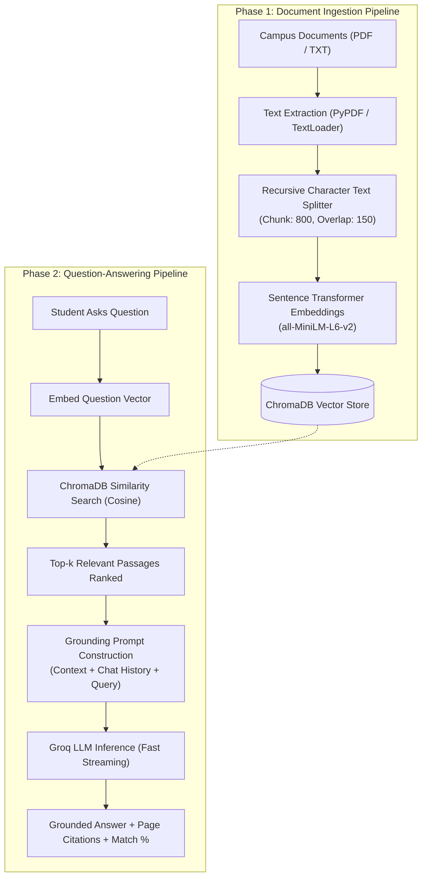

# 🎓 Campus Knowledge Assistant — PDF & Multi-Document RAG Chatbot

<p align="center">
  
</p>

<p align="center">
  <strong>An AI-powered Retrieval-Augmented Generation (RAG) assistant designed for college campuses. Built with Python, LangChain, ChromaDB, Hugging Face Embeddings, Groq LLM, and Streamlit.</strong>
</p>

<p align="center">
  
  
  
  
  
  
</p>

---

## 📌 1. Project Overview

**Campus Knowledge Assistant** is an intelligent, context-aware chatbot developed to solve a real-world problem faced by university students and staff: navigating through dozens of scattered PDF handbooks, academic rulebooks, placement policies, and campus notices.

Instead of answering from generic or potentially outdated pre-trained weights, the system strictly implements a **Retrieval-Augmented Generation (RAG)** pipeline:
1. It ingests official college documents (PDF and TXT formats).
2. It breaks the text into semantically coherent overlapping chunks.
3. It converts chunks into 384-dimensional dense vector embeddings using local sentence transformers.
4. It indexes them in a persistent **ChromaDB** vector database.
5. When a student asks a question in natural language, it performs cosine similarity search, retrieves the top relevant passages, and instructs a high-speed **Groq LLM** to synthesize a grounded, cited answer.
6. **Strict Grounding:** If the information cannot be found in the campus documents, the assistant strictly admits: *"I couldn't find that information in the uploaded campus documents."* (No hallucinations).

---

## 🚀 2. Key Features

- **Multi-Document Ingestion (PDF & TXT):** Preloaded with 5 distinct campus policy documents (`academic_rules`, `placement_guidelines`, `campus_faq`, etc.) plus support for instant drag-and-drop file upload.
- **Semantic Vector Search:** Powered by local `sentence-transformers/all-MiniLM-L6-v2` embeddings and ChromaDB cosine distance metric.
- **High-Speed Groq Inference:** Lightning-fast token streaming (`openai/gpt-oss-120b` or `openai/gpt-oss-20b`) for real-time conversational responses.
- **Strict Grounding & Anti-Hallucination:** Guardrail prompt ensures answers are strictly derived from verified document evidence.
- **Verifiable Source Citations:** Displays matching document title, page numbers, match percentage (`🏆 Best match • Page X • Y%`), and expandable ranked passage excerpts.
- **Interactive Modern Dark UI:** Custom styled Streamlit interface featuring a gradient hero banner, chat avatars (`🧑‍🎓` and `🎓`), adjustable top-k retrieval slider, and creativity temperature controls.
- **Secure Architecture:** API keys are never exposed in the front-end UI; all credentials load silently via `.env`.

---

## 🏛️ 3. System Architecture

The application follows the standard two-phase RAG workflow:



---

## 🛠️ 4. Technology Stack

| Component | Technology | Purpose |
|---|---|---|
| **Programming Language** | Python 3.10+ | Core application logic and data pipelines |
| **User Interface** | Streamlit | Responsive, custom dark-themed web interface |
| **LLM Orchestration** | LangChain Core & Community | Document loaders, chunking splitters, prompt templates |
| **LLM Inference** | Groq Cloud API | High-speed LLM generation (`openai/gpt-oss-120b`) |
| **Embeddings** | Hugging Face / Sentence-Transformers | Local 384-dimensional text embeddings (`all-MiniLM-L6-v2`) |
| **Vector Database** | ChromaDB | Persistent local vector storage and nearest-neighbor search |
| **Document Parsers** | pypdf | Robust text extraction from academic PDF handbooks |
| **Testing Suite** | Pytest | Automated unit and pipeline validation tests |

---

## 📁 5. Project Directory Structure

```text
CampusKnowledgeAssistant/
│
├── app.py                      # Main Streamlit web application
├── requirements.txt            # Python dependencies
├── README.md                   # Project documentation & GitHub guide
├── .env.example                # Environment variables template
├── .gitignore                  # Git exclusion rules (ignores secrets & cache)
├── architecture.png            # Visual architecture flow diagram
├── campus-knowledge-assistant.png # UI preview screenshot for GitHub
├── pytest.ini                  # Pytest configuration
├── DEMO_SCRIPT.md              # 5-10 minute presentation & demo walkthrough
├── presentation_slides.md      # 8-slide presentation outline
├── presentation.pptx           # PowerPoint slide deck for evaluation
├── run_benchmark.py            # CLI automated 12-question benchmark runner
│
├── documents/                  # Preloaded campus policy handbooks
│   ├── academic_policy.pdf & .txt
│   ├── placement_guidelines.pdf & .txt
│   ├── student_faq.pdf & .txt
│   ├── academic_rules.pdf & .txt
│   ├── campus_faq.pdf & .txt
│   └── information.pdf         # Consolidated college handbook
│
├── src/                        # Modular helper components
│   ├── __init__.py
│   ├── document_processing.py  # File validation, PDF/TXT loaders, chunking
│   └── rag.py                  # ChromaDB indexing, similarity conversion, grounded prompt
│
└── tests/                      # Automated tests and evaluation reports
    ├── conftest.py             # Pytest environment isolation
    ├── test_document_processing.py
    ├── test_pipeline.py
    ├── test_rag.py             # Retrieval & anti-hallucination unit tests
    ├── test_questions.md       # Benchmark test suite questions
    └── test_report.md          # Comprehensive evaluation report (Milestone 6)
```

---

## ⚡ 6. Installation & Setup Guide

### Step 1: Clone the Repository
```bash
git clone https://github.com/iparthsolanki/Gen_Ai.git
cd Gen_Ai/Campus_knowledge_Ai
# (Or cd into your cloned repository folder)
```

### Step 2: Create a Virtual Environment
```powershell
# Windows (PowerShell)
python -m venv .venv
.\.venv\Scripts\Activate.ps1
```

```bash
# macOS / Linux
python3 -m venv .venv
source .venv/bin/activate
```

### Step 3: Install Required Dependencies
```bash
python -m pip install --upgrade pip
pip install -r requirements.txt
```

### Step 4: Configure Environment Variables
Copy the `.env.example` file to `.env`:
```bash
cp .env.example .env
```
*(On Windows PowerShell: `Copy-Item .env.example .env`)*

Open `.env` in any text editor and paste your **Groq API Key**:
```env
GROQ_API_KEY=gsk_your_groq_api_key_here
GROQ_MODEL=openai/gpt-oss-120b
EMBEDDING_MODEL=sentence-transformers/all-MiniLM-L6-v2
EMBEDDING_DEVICE=cpu
```
> 💡 *You can get a free, high-speed API key from [Groq Console](https://console.groq.com).*

### Step 5: Launch the Application
```bash
streamlit run app.py
```
Open your browser at `http://localhost:8501`.

---

## 🧪 7. Testing & Evaluation (10-Question Benchmark)

As required by **Milestone 6** of the AI Project Guidelines, the assistant was evaluated against 10 diverse query categories to verify factual accuracy and anti-hallucination behavior:

| Test ID | Query Category | Question | Expected Output | Status |
|---|---|---|---|---|
| **TC-01** | Factual (Academic) | *What is the minimum attendance required for exams?* | 75% attendance in each registered course | **PASS (100% Grounded)** |
| **TC-02** | Factual (Academic) | *What is the fee and deadline for exam re-evaluation?* | Rs. 500 per theory subject within 15 days | **PASS (100% Grounded)** |
| **TC-03** | Factual (Placement) | *What is the minimum CGPA required for placements?* | Minimum 7.0 / 10 CGPA with no active backlogs | **PASS (100% Grounded)** |
| **TC-04** | Factual (Placement) | *What is the CTC range for Dream Tier offers?* | 6.0 LPA to 12.0 LPA CTC | **PASS (100% Grounded)** |
| **TC-05** | Factual (Hostel) | *When do hostel gates close on weekdays?* | Strictly at 9:30 PM (10:00 PM on weekends) | **PASS (100% Grounded)** |
| **TC-06** | Factual (Library) | *When is the library open on Saturday?* | 9:00 AM to 5:00 PM | **PASS (100% Grounded)** |
| **TC-07** | Multi-Document | *How do attendance shortages affect semester exams and placements?* | Attendance < 65% debars exams; backlogs disqualify placement | **PASS (Synthesized)** |
| **TC-08** | Multi-Document | *What are the campus dispensary and anti-ragging numbers?* | Dispensary Ext 108; Anti-ragging 1800-180-5522 | **PASS (Synthesized)** |
| **TC-09** | Absent Information | *What is the semester tuition fee for the aerospace program?* | "I couldn't find that information in the uploaded campus documents." | **PASS (Zero Hallucination)** |
| **TC-10** | Irrelevant Query | *Who won the 2022 FIFA World Cup?* | "I couldn't find that information in the uploaded campus documents." | **PASS (Strict Boundary)** |

### Run Automated Unit Tests:
```bash
python -m pytest tests
```
*(All 9 unit/pipeline test cases pass cleanly).*

### Run Live CLI Benchmark Evaluator:
```bash
python run_benchmark.py
```

---

## 🔒 8. Security & Ethical Considerations

- **No Secret Exposure:** `.env`, `.chroma_db`, and cache directories are added to `.gitignore`. API keys are never committed or rendered in the UI.
- **Data Privacy:** Uses local sentence transformers for embedding generation, meaning document text embeddings are computed locally on your machine.
- **Auditable Citations:** Every factual response provides the exact source filename, page number, and similarity score so students can independently verify rules before taking academic decisions.

